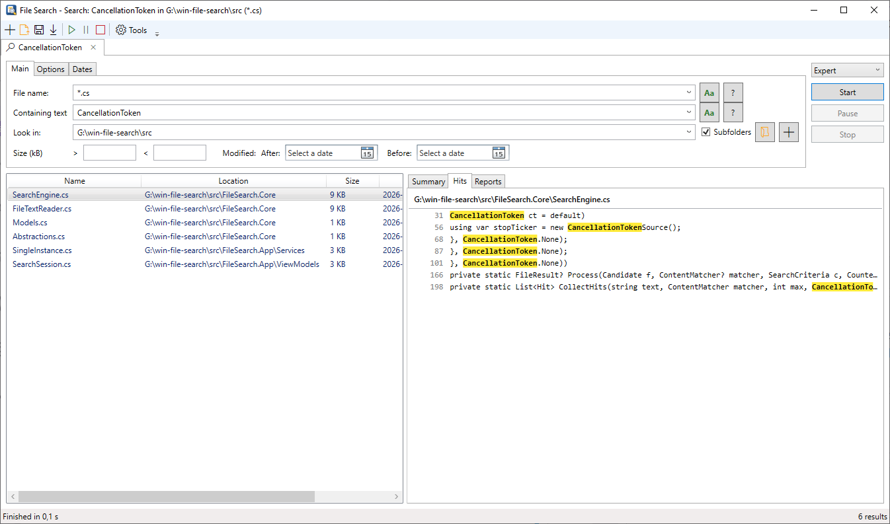

<p align="center"></p>

# File Search

[](https://github.com/vladano/win-file-search/actions/workflows/ci.yml)
[](https://github.com/vladano/win-file-search/releases/latest)
[](https://github.com/vladano/win-file-search/releases)
[](LICENSE)


[](#how-this-app-was-built)

**Find text inside thousands of files, across a folder and all its subfolders, in seconds.** Windows' built-in search is poor at this. File Search is a free, open-source desktop app for it: plain, Boolean (`AND`/`OR`/`NOT`) or regex search, Word, Excel, PowerPoint and PDF support, and a **Search with File Search** entry in the Explorer right-click menu.

**[⬇ Download the latest release](https://github.com/vladano/win-file-search/releases/latest)**: one portable `FileSearch.exe`, no installer, no .NET install needed. Windows 10 and 11, x64.



### Why File Search

- **Searches content, not just names.** Every matching line is listed with its line number and the match highlighted.
- **Real queries.** `alias AND (select OR use) NOT "for test"`, regular expressions, wildcards for file names, size and date filters, folder exclusions.
- **Office and PDF files included.** No IFilters or Windows Search index needed.
- **Right where you are.** Right-click any folder, folder background or drive in Explorer.
- **Portable and private.** One exe, settings in `%AppData%`, no network connections, no telemetry.
- **Free for personal and business use.** [MIT license](LICENSE).

It is an independent project inspired by [Agent Ransack](https://www.mythicsoft.com/agentransack/) (see [Inspiration and disclaimer](#inspiration-and-disclaimer)). Built with C# on .NET 9 and WPF, with the help of the AI development environment [Kiro](https://kiro.dev) (see [How this app was built](#how-this-app-was-built)).

## Quick start

1. Download `FileSearch-<version>-win-x64.zip` from [Releases](https://github.com/vladano/win-file-search/releases/latest) and unzip it, for example to `C:\Tools\FileSearch`.
2. Run `FileSearch.exe`. The exe is not code-signed yet, so Windows SmartScreen may warn the first time. Click **More info > Run anyway**.
3. Optional: **Tools > Add to Explorer context menu**. On Windows 11 the entry is under **Show more options**.
4. Enter a file name pattern (for example `*.cs;*.sql`), the text to find and a folder, then press **Start** (or F5).

## Features

| Area | What it does |
| --- | --- |
| File name | DOS wildcards (`*`, `?`), several patterns separated by `;` or `,`, or a regular expression. Optional match case. |
| Containing text | Plain text, Boolean (`AND`, `OR`, `NOT`, parentheses, `"quoted phrases"`) or regular expression. Optional match case. |
| Look in | One or more folders (separate with `;`), with or without subfolders. Folder history is remembered. |
| Filters | Size (greater / less than, in kB). Modified, Created and Last Accessed date ranges. Folder exclusions such as `.git; node_modules`. |
| Documents | Searches inside Word, Excel and PowerPoint (`.docx/.xlsx/.pptx` and macro variants) and PDF files. |
| Results | Name, Location, Size, Modified and Hits columns (click a header to sort). Summary, Hits (matched text highlighted) and Reports tabs. |
| Control | Start, Pause / Resume and Stop. Several searches at once in tabs. |
| Files | Save and open search definitions (`.fsearch`). Export results to TXT or CSV. |
| Modes | Simple hides the advanced options (Size, Dates, Options tabs). Expert shows everything. |
| Explorer | Right-click a folder, the background of a folder, or a drive to start a search there. |

Notes:

- Text files are decoded automatically (UTF-8, UTF-16/32 with BOM, otherwise ANSI/Latin-1). Binary files and files above 100 MB are skipped and counted as "Skipped" in the summary.
- Excel search covers text cells only (not numbers or formulas).
- Hidden and system files are included. Junctions and symbolic links are not followed, which avoids link loops.

## Requirements

- Windows 10 or 11
- [.NET 9 SDK](https://dotnet.microsoft.com/download/dotnet/9.0) to build (`dotnet --version` should print 9.x)
- The published single-file build is self-contained and needs no .NET install to run

## Build

```powershell
git clone https://github.com/vladano/win-file-search.git
cd win-file-search

dotnet restore
dotnet build FileSearch.sln -c Release
```

`global.json` pins the SDK to 9.0 (any newer 9.0.x feature band is accepted). The build treats warnings as errors.

The app is written to `src\FileSearch.App\bin\Release\net9.0-windows\FileSearch.exe`.

## Run

```powershell
dotnet run --project src/FileSearch.App
```

Command line options:

```text
FileSearch.exe [folder] [--name <pattern>] [--text <text>] [--start]
FileSearch.exe --install-shell      add the Explorer context menu entries
FileSearch.exe --uninstall-shell    remove them
```

Examples:

```powershell
FileSearch.exe "C:\Projects"
FileSearch.exe "C:\Projects" --name "*.cs;*.xaml" --text "ALIAS" --start
```

Only one instance runs per user. Starting the app again (for example from the context menu) opens a new tab in the running window.

## Test

```powershell
dotnet test FileSearch.sln
```

Run one project, or filter by name:

```powershell
dotnet test tests/FileSearch.Core.Tests
dotnet test tests/FileSearch.App.Tests
dotnet test FileSearch.sln --filter "FullyQualifiedName~SearchEngine"
```

There are two xUnit projects. Tests create their own temporary folders and settings file, and clean them up. They never touch your real `%AppData%\FileSearch\settings.json` or the registry (settings created in code have no file, so saving them does nothing).

**`tests/FileSearch.Core.Tests`** (the engine)

- File name matching: DOS wildcards, lists, regex, match case, invalid patterns
- Content matching: plain, regex, Boolean parsing and precedence, invalid expressions, highlight ranges and merging
- File reading: UTF-8/16/32, BOM and no BOM, Latin-1 fallback, line endings, binary and oversized files, locked files, Word/Excel/PowerPoint/PDF extraction, corrupt documents
- The engine on a temporary folder tree: subfolders, several folders, hits and line numbers, hit cap, long-line windowing, size and Modified/Created/Accessed filters, excluded folders, hidden files, junction loops, progress and summary, pause, resume and cancel
- Report export (TXT and CSV escaping), criteria helpers, date ranges, `PauseControl`
- Logging of recovered problems, and the size limit that protects against documents that unpack to huge text

**`tests/FileSearch.App.Tests`** (the application layer, no windows are shown)

- Command line parsing, including the `C:\` quoting quirk from Explorer
- Settings and saved search definitions: history, save/load, corrupt files, migration of version 1 files, and a test that every saved-search field survives the view model and the file
- Dialog flows (open/save/export, folder pickers, error reporting) using a fake `IDialogService`, and searches through a fake `ISearchEngine`
- The log file (`AppLog`)
- View models: running searches end to end, error reporting, history, stop/pause, tabs, definitions, date filters
- `HitTextBlock` highlighting and the value converters

**Not covered by automated tests** (check these by hand): the window layout (`MainWindow`, `SearchTabView`), `SingleInstance` (it uses a per-user mutex and pipe that would clash with a running copy), and `ShellIntegration` (it writes to the real registry).

Coverage report (needs the `coverlet.collector` package, already referenced):

```powershell
dotnet test FileSearch.sln --collect:"XPlat Code Coverage"
```

## Install

### Portable (single file)

The easiest way is the zip on the [Releases](https://github.com/vladano/win-file-search/releases/latest) page. It contains `FileSearch.exe` (about 60 MB, self-contained), `LICENSE`, `THIRD-PARTY-NOTICES.md` and this README. A `.sha256` file next to it lets you check the download:

```powershell
Get-FileHash .\FileSearch-0.1.0-win-x64.zip -Algorithm SHA256
```

To build the same exe yourself:

```powershell
dotnet publish src/FileSearch.App -c Release -r win-x64 --self-contained -p:PublishSingleFile=true -o publish
```

Copy `publish\FileSearch.exe` anywhere, for example `C:\Tools\FileSearch\`, and run it. When you share it, include `LICENSE` and `THIRD-PARTY-NOTICES.md` next to the exe.

### Making a release (maintainers)

Releases are built by `.github/workflows/release.yml` when a version tag is pushed:

```powershell
git switch main
git pull
git tag v0.1.0
git push origin v0.1.0
```

The workflow runs the tests, publishes the single-file exe with the tag's version, zips it with the license files, and creates the GitHub release with a checksum and generated notes. The text at the top of the notes comes from `.github/release-notes.md`.

### Explorer context menu

From the app: **Tools > Add to Explorer context menu**. Or from a terminal:

```powershell
C:\Tools\FileSearch\FileSearch.exe --install-shell
```

This writes only to the current user's registry (`HKCU`, no administrator rights needed):

```text
HKCU\Software\Classes\Directory\shell\FileSearch                  right-click a folder
HKCU\Software\Classes\Directory\Background\shell\FileSearch       right-click inside a folder
HKCU\Software\Classes\Drive\shell\FileSearch                      right-click a drive
```

- On **Windows 11** the entry is listed under **Show more options** (or press Shift+F10). A first-level entry on the short menu needs a sparse MSIX package with an `IExplorerCommand` handler, which is not implemented yet.
- The menu entry stores the full path to `FileSearch.exe`. If you move the file, run **Add to Explorer context menu** again.
- To remove it: **Tools > Remove from Explorer context menu**, or `FileSearch.exe --uninstall-shell`.

### Settings and log

Search history, Simple/Expert mode and window position are stored in `%AppData%\FileSearch\settings.json`. Delete the file to reset them.

Problems the app recovers from (unreadable files, failed exports, unexpected errors) are written to `%AppData%\FileSearch\logs\filesearch.log`. At 1 MB it is renamed to `filesearch.old.log`, so it stays small. Attach this file to bug reports.

Both `settings.json` and `.fsearch` files carry a `Version` number and store modes by name (`"ContentMode": "Boolean"`). Older files that stored combo box positions are converted when they are loaded.

## Search syntax

| Mode | Example | Meaning |
| --- | --- | --- |
| File name, DOS | `*.cs;*.xaml` | Any `.cs` or `.xaml` file |
| File name, DOS | `report?.txt` | `report1.txt`, `reportA.txt` ... |
| File name, regex | `^\d+\.log$` | Log files named with digits only |
| Contents, plain | `ALIAS` | The exact text |
| Contents, Boolean | `alias AND (select OR use) NOT "for test"` | Operators must be upper case. Words next to each other mean AND. |
| Contents, regex | `^\s*ALIAS\b` | .NET regular expression. `^` and `$` match at line start and end. |

The `Aa` button next to a field toggles case sensitivity. The `?` button shows this help in the app.

## Project layout

```text
win-file-search/
├─ FileSearch.sln
├─ global.json, Directory.Build.props, Directory.Packages.props, .editorconfig
│                                 SDK pin, shared build settings (warnings are errors), package versions, code style
├─ .github/                       CI and release workflows, Dependabot, issue forms, PR template
├─ docs/                          screenshot, icon.png and social preview image used by the README and GitHub
├─ tools/icon/make-icon.ps1       generates the app icon (Assets/FileSearch.ico) and docs/icon.png
├─ LICENSE                        MIT license (with the repository link)
├─ THIRD-PARTY-NOTICES.md         licenses of the packages used
├─ CONTRIBUTING.md, CODE_OF_CONDUCT.md, SECURITY.md
│                                 how to contribute, community rules, how to report security problems
├─ src/
│  ├─ FileSearch.Core/            UI-free search engine (class library)
│  │   ├─ SearchCriteria.cs       what to search: folders, name, text, modes, size, dates
│  │   ├─ NameMatcher.cs          DOS wildcard / regex file name matching
│  │   ├─ ContentMatcher.cs       plain / regex / Boolean matching and hit highlighting
│  │   ├─ FileTextReader.cs       encoding detection, binary check, docx/xlsx/pptx and PDF text
│  │   ├─ SearchEngine.cs         parallel pipeline, progress, pause, cancel
│  │   ├─ Abstractions.cs         ISearchEngine, ISearchLogger
│  │   ├─ SearchTuning.cs         engine constants (queue size, timeouts, limits) in one place
│  │   ├─ ReportBuilder.cs        TXT and CSV export
│  │   └─ Models.cs               FileResult, Hit, SearchProgress, PauseControl
│  └─ FileSearch.App/             WPF application (assembly name: FileSearch)
│      ├─ Assets/FileSearch.ico   app icon (exe, windows, taskbar, Explorer context menu)
│      ├─ App.xaml(.cs)           startup, command line, single instance
│      ├─ MainWindow.xaml(.cs)    toolbar, search tabs, status bar
│      ├─ SearchTabView.xaml(.cs) Main / Options / Dates tabs, results list, Summary / Hits / Reports
│      ├─ HitTextBlock.cs         text block that highlights matched ranges
│      ├─ ViewModels/             MainViewModel (tabs, dialog flows), SearchTabViewModel (form and results),
│      │                          SearchSession (runs one search, batches results), helpers (MVVM)
│      └─ Services/               settings, command line, single instance, Explorer registration, saved searches,
│                                 IDialogService, AppLog, HelpText
├─ tests/FileSearch.Core.Tests/   xUnit tests for the engine
├─ tests/FileSearch.App.Tests/    xUnit tests for view models, settings, command line
└─ start/                         design references (screenshots, notes); ignored by git
```

### Adding things

- **A new search option:** add it to `SearchCriteria`, the `SearchTabViewModel` (property, `BuildCriteria`, `ToDefinition`, `ApplyDefinition`), `SearchDefinition` and the XAML. `DefinitionMappingTests` fails and names the field if you forget a mapping.
- **A new mode in a combo box:** add the enum value and its `ModeOption` in `SearchTabViewModel`. `EveryModeHasAnOptionInTheUi` fails if you forget the option. Never store a combo box position in a file.
- **A new dialog or message:** add it to `IDialogService` and call it from a view model, not from a window.
- **A change to a saved file format:** bump `CurrentVersion` in `AppSettings` or `SearchDefinition` and convert old values when loading.
- **A change to the icon:** edit the drawing code in `tools/icon/make-icon.ps1` and run `pwsh -File tools/icon/make-icon.ps1` from the repository root. It rewrites `src/FileSearch.App/Assets/FileSearch.ico` (16 to 256 px; sizes below 32 px are drawn with less detail) and `docs/icon.png`. The exe uses it through `ApplicationIcon`, and the windows through a WPF `Resource` item. `AppIconTests` checks that it is embedded and has every size.

### How a search runs

1. `SearchTabViewModel` builds a `SearchCriteria` from the form and hands it to a `SearchSession`, which calls `ISearchEngine.RunAsync`.
2. One producer enumerates files with `FileSystemEnumerable`. The name, size and date filters are applied while enumerating, so unwanted files are never opened.
3. Candidates go through a bounded channel to a pool of workers (one per CPU core, minimum two).
4. Each worker reads the file text, evaluates the content expression, and collects matching lines with highlight ranges.
5. Results are queued and added to the list in batches every 100 ms, so the UI stays responsive on large result sets. Progress is reported every 150 ms.

## Implementation plan and status

| Phase | Scope | Status |
| --- | --- | --- |
| 1. Search engine | Criteria, enumerator, name and content matchers, size/date filters, text decoding, parallel pipeline with pause/cancel/progress, hits with line numbers | Done, unit tested |
| 2. WPF UI | Window and tabs from the reference screenshots, results list, Summary / Hits / Reports, Start / Pause / Stop, Simple/Expert, history, settings | Done |
| 3. Explorer and standalone | Command line, single instance, context menu for folders, backgrounds and drives (registry, no admin) | Done. Registration not yet tried on a real Explorer menu. |
| 4. Document search | Word, Excel, PowerPoint and PDF text extraction | Done, unit tested (docx, xlsx, pptx and a generated PDF). |
| 5. Extras | Saved searches, export TXT/CSV, multiple folders, excluded folders | Done. Printing and context lines around a hit are not done. |
| 6. Packaging | Single-file publish, release workflow | Done: compressed self-contained exe, zip and checksum built by the release workflow on a version tag. App icon done (v0.1.1). Code signing, an installer (Inno Setup or WiX) and winget/Scoop packages are still to do. |

Ideas not started: first-level Windows 11 context menu (sparse MSIX with `IExplorerCommand`), printing, lines of context around hits, file type icons in the results list, opening a file at the hit line, an installer.

## Troubleshooting

- **The context menu entry is missing on Windows 11.** Look under "Show more options".
- **The build says the SDK is missing.** Install the .NET 9 SDK and reopen the terminal.
- **A folder is reported as not found.** Check the "Look in" field. Several folders are separated with `;`.
- **A regular expression or Boolean search shows an error.** The message appears in the Status line of the Summary tab and the status bar.
- **Files are listed under Skipped.** They are binary, larger than 100 MB (or Office/PDF documents that unpack to more than that), locked, or could not be read. The log file says why for each unreadable file.

## How this app was built

File Search was built with [Kiro](https://kiro.dev), the agentic AI development environment from AWS. The project is a practical example of AI-assisted development: a working, tested Windows desktop app, taken from a few screenshots and a one-paragraph idea to a public release.

**What the maintainer did**

- Defined the problem (searching file contents across folders, which Windows search does poorly) and the target experience, using screenshots of a reference app.
- Made the product and technical decisions: C# with WPF on .NET 9, a classic Explorer context-menu entry (no admin rights, works on Windows 10 and 11) instead of a packaged Windows 11 extension, the MIT license, and the release approach.
- Reviewed the plan, the code and the documentation, ran the app, and decided what to keep, change or drop.

**What Kiro did, under that direction**

- Analyzed the reference screenshots and wrote the implementation plan (the phases in [Implementation plan and status](#implementation-plan-and-status)).
- Wrote the code: the search engine, the WPF interface, single-instance handling, Explorer integration, and Office and PDF text extraction.
- Wrote the unit tests and ran them after each change. It checked a sample of them by breaking code on purpose and confirming the tests failed.
- Built and launched the app to check real searches, the single-instance behaviour and the release build, and took the screenshots in `docs/`.
- Wrote the README, the contributing and security guides, the CI and release workflows, and applied the dependency updates.

**What that means for you**

- AI-generated code is treated like any other contribution: it has to build without warnings, pass the tests and CI, and make sense to a human reviewer. The engine and view models have broad unit-test coverage. The window layout, the Explorer registration and the single-instance pipe are checked by hand (see [Test](#test)).
- If you find a bug, it is a normal bug. Please [open an issue](https://github.com/vladano/win-file-search/issues/new/choose).
- Contributions are welcome whether you write the code yourself or with an AI tool, as long as you understand it and it meets the same bar.

Kiro and AWS are trademarks of Amazon.com, Inc. or its affiliates. This project is not affiliated with or endorsed by AWS.

## Contributing

Bug reports, ideas and pull requests are welcome. See [CONTRIBUTING.md](CONTRIBUTING.md) for how to build, test and submit changes, and [SECURITY.md](SECURITY.md) for reporting security problems privately. If File Search saves you time, a ⭐ on GitHub helps other people find it.

## License

File Search is released under the [MIT License](LICENSE). You may use, copy, modify and distribute it freely, for personal and commercial use. The only condition is that the copyright and license notice, which includes the link to <https://github.com/vladano/win-file-search>, stays with copies and substantial portions of the software (including redistributed binaries).

Third-party packages keep their own licenses. See [THIRD-PARTY-NOTICES.md](THIRD-PARTY-NOTICES.md).

## Inspiration and disclaimer

This is an independent project. Its layout and feature set were inspired by [Agent Ransack](https://www.mythicsoft.com/agentransack/). It is not affiliated with, endorsed by, or derived from code of Mythicsoft. Agent Ransack is a trademark of Mythicsoft Ltd. The reference screenshots used while designing the app are kept locally in `start/` and are not part of this repository.
