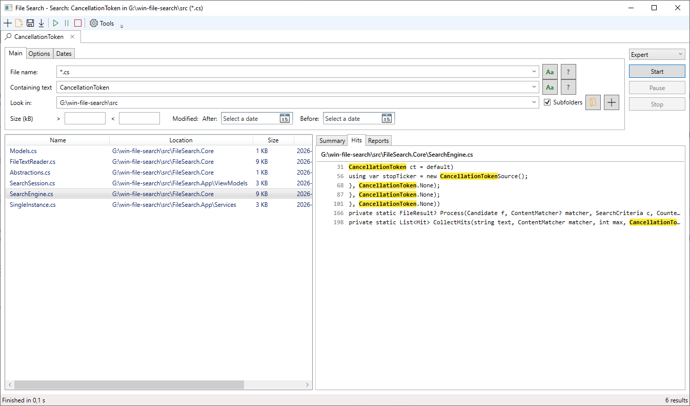

# File Search user manual

File Search finds text inside files: every file in a folder and its subfolders that contains what you are looking for, with the matching lines listed and highlighted. This manual explains how to install it, add it to the Explorer right-click menu, and use every part of the window.

Applies to File Search 0.1.2 and later, on Windows 10 and Windows 11 (64-bit).



## Contents

1. [Install](#1-install)
2. [Add File Search to the Explorer right-click menu](#2-add-file-search-to-the-explorer-right-click-menu)
3. [Your first search](#3-your-first-search)
4. [The window at a glance](#4-the-window-at-a-glance)
5. [The search form](#5-the-search-form)
6. [Writing searches: file names and text](#6-writing-searches-file-names-and-text)
7. [Working with the results](#7-working-with-the-results)
8. [Several searches at once](#8-several-searches-at-once)
9. [Saving searches and exporting results](#9-saving-searches-and-exporting-results)
10. [Starting File Search from the command line](#10-starting-file-search-from-the-command-line)
11. [Keyboard shortcuts](#11-keyboard-shortcuts)
12. [What gets searched (and what is skipped)](#12-what-gets-searched-and-what-is-skipped)
13. [Settings, history and the log file](#13-settings-history-and-the-log-file)
14. [Update and uninstall](#14-update-and-uninstall)
15. [Troubleshooting](#15-troubleshooting)

---

## 1. Install

File Search is a single program file. There is no installer and you do not need to install .NET.

1. Open the [Releases page](https://github.com/vladano/win-file-search/releases/latest) and download `FileSearch-<version>-win-x64.zip`.
2. Right-click the zip and choose **Extract All...**. Pick a permanent folder, for example `C:\Tools\FileSearch`.
   - Choose a folder you will keep. The Explorer right-click entry (next section) remembers where the program is.
   - A folder under your user profile or `C:\Tools` works fine. Administrator rights are not needed.
3. Double-click `FileSearch.exe`.

**"Windows protected your PC".** The program is not code-signed yet, so Windows SmartScreen may show this message the first time. Click **More info**, then **Run anyway**. Windows remembers the choice.

**Check the download (optional).** Each release has a `.sha256` file. In PowerShell, in the download folder:

```powershell
Get-FileHash .\FileSearch-0.1.1-win-x64.zip -Algorithm SHA256
```

The hash printed must match the one in the `.sha256` file.

**Pin it (optional).** While File Search is running, right-click its taskbar icon and choose **Pin to taskbar**. To add it to Start, right-click `FileSearch.exe` and choose **Pin to Start**.

## 2. Add File Search to the Explorer right-click menu

With the menu entry installed, you can right-click any folder and search it straight away.

### Add the entry

1. Start File Search.
2. Open **Tools** in the toolbar and choose **Add to Explorer context menu**.
3. A message confirms that **Search with File Search** was added.

The entry appears when you right-click:

| Where you right-click | What File Search searches |
| --- | --- |
| A folder | That folder |
| The empty background inside an open folder | The folder you are in |
| A drive, for example `C:` in **This PC** | The whole drive |

**On Windows 11** the classic entries are in the extended menu: right-click, then choose **Show more options** (or press **Shift+F10**, or hold **Shift** while you right-click). On Windows 10 the entry is in the normal menu.

### Use it

1. Right-click a folder and choose **Search with File Search**.
2. File Search opens with **Look in** already set to that folder and the cursor in **File name**.
3. Enter what you are looking for and press **Enter** (or **F5**).

The entry fills in the folder but does not start a search by itself, so you can type the text first. If File Search is already open, the folder opens in a **new search tab** in the same window instead of a second window.

### Details and removal

- The entry is added for your Windows user only, so no administrator rights are needed. Other users of the PC do not get it.
- It stores the full path of `FileSearch.exe`. **If you move or rename the program folder, choose Add to Explorer context menu again** from the new location, otherwise the entry stops working.
- To remove the entry: **Tools > Remove from Explorer context menu**.
- The same can be done from a command prompt, which is handy for scripts:

  ```powershell
  C:\Tools\FileSearch\FileSearch.exe --install-shell
  C:\Tools\FileSearch\FileSearch.exe --uninstall-shell
  ```

  These run silently (no window), and only show a message if something goes wrong.

For the curious, these are the registry keys it writes:

```text
HKEY_CURRENT_USER\Software\Classes\Directory\shell\FileSearch
HKEY_CURRENT_USER\Software\Classes\Directory\Background\shell\FileSearch
HKEY_CURRENT_USER\Software\Classes\Drive\shell\FileSearch
```

## 3. Your first search

Say you want every `.sql` file under `D:\Projects` that mentions `customer_id`.

1. **File name:** type `*.sql`
2. **Containing text:** type `customer_id`
3. **Look in:** type `D:\Projects`, or click the yellow folder button to browse. Leave **Subfolders** ticked.
4. Click **Start** or press **Enter**.

While it runs, the **Summary** tab on the right counts the files checked and found, and found files appear in the list on the left as soon as they are found. When it finishes, the status bar shows how long it took.

5. Click a file in the list. The right pane switches to **Hits** and shows every matching line with its line number, the match highlighted in yellow.
6. Double-click the file to open it in its usual program.

To find files by name only, leave **Containing text** empty. To search every file, set **File name** to `*`.

## 4. The window at a glance

```text
┌ Toolbar: New · Open · Save · Export │ Start · Pause · Stop │ Tools ───────────────────────┐
├ Search tabs:  [customer_id ×] [TODO ×] ...                                                ┤
├ Search form:  Main | Options | Dates                              [Simple/Expert] Start   ┤
│               File name / Containing text / Look in / Size / Modified             Pause   │
│                                                                                   Stop    │
├ Results list (left)                     │ Details (right): Summary | Hits | Reports       ┤
│ Name · Location · Size · Modified · Hits│                                                 │
└ Status bar: progress or "Finished in 1.2 s"                               "6 results"     ┘
```

**Toolbar**

| Button | What it does |
| --- | --- |
| **+** New search | Opens a new search tab (Ctrl+N) |
| Open | Opens a saved search (`.fsearch` file) in a new tab |
| Save | Saves the current search form to a `.fsearch` file |
| Export | Saves the current results as a text report or CSV file |
| ▷ Start | Starts the search in the current tab (F5) |
| ⏸ Pause | Pauses the running search; click again to resume |
| ■ Stop | Stops the search; results found so far stay in the list |
| **Tools** | Add or remove the Explorer context-menu entry, and open the search syntax help |
| ⓘ **About** | Shows the version and license, with links to the source code on GitHub, this manual, new versions and the issue tracker. **Copy details** copies the version and Windows details for a bug report. |

The **Start**, **Pause** and **Stop** buttons are also to the right of the search form. Pause and Stop are only available while a search is running.

## 5. The search form

### Simple and Expert mode

The drop-down above the **Start** button switches between:

- **Expert** (default): everything is visible, including the size and date filters and the **Options** and **Dates** tabs.
- **Simple**: only File name, Containing text and Look in.

The choice applies to all tabs and is remembered.

> **Note:** Simple mode only hides the advanced fields. Anything you set in Expert mode (size limits, dates, excluded folders, match case, search modes) **still applies**. If a search finds less than you expect, switch to Expert and check the Options and Dates tabs.

### Main tab

| Field | What to enter |
| --- | --- |
| **File name** | Which files to look at, for example `*.cs` or `*.cs;*.xaml`. Empty or `*` means all files. See [section 6](#6-writing-searches-file-names-and-text). |
| **Containing text** | The text to find inside the files. Empty means "match by name only". |
| **Look in** | The folder to search. Separate several folders with `;`, for example `C:\Work;D:\Archive`. Environment variables such as `%USERPROFILE%\Documents` work. |
| **Subfolders** | Ticked: also search every folder below. Unticked: only the folder itself. |
| **Size (kB)** `>` and `<` | Only files larger than / smaller than this many kilobytes (whole numbers). Leave empty for no limit. |
| **Modified After / Before** | Only files last changed on or after / on or before the chosen day. |

Buttons next to the fields:

- **Aa** turns on *match case* for that field (`Alias` then no longer matches `alias`). It is pressed in when active.
- **?** shows a short summary of the search syntax.
- The yellow **folder** button opens a folder picker for Look in. The **+** button next to it adds another folder to the list.

The three main fields remember your last 25 entries. Click the arrow at the right of a field to pick an earlier one.

### Options tab (Expert)

| Option | Meaning |
| --- | --- |
| **File name:** DOS Expression / Regular expression | How the File name field is read. See [section 6](#6-writing-searches-file-names-and-text). |
| **Contents:** Plain text / Boolean / Regular expression | How the Containing text field is read. |
| **Match case** | The same as the **Aa** buttons on the Main tab. |
| **Office/PDF documents** | Ticked (default): also search the text inside Word, Excel, PowerPoint and PDF files. Untick for faster searches of plain text files only. |
| **Exclude folders** | Folder names to skip, separated by `;` or `,`, for example `.git; node_modules; bin; obj`. Wildcards work (`obj*`). Matching ignores case. |

### Dates tab (Expert)

Filter by **Modified**, **Created** and **Last Accessed** date. Each has an **After** and a **Before** box.

- Tick a box or pick a date to use it. The two stay in sync: picking a date ticks the box, unticking clears the date.
- Dates are whole days and inclusive. *After 1 March* includes files from 1 March, and *Before 31 March* includes files from 31 March.
- **Clear All** removes every date filter.
- The Modified dates on the Main tab are the same filters as on this tab.

> Windows often does not update **Last Accessed** times, so that filter may not be reliable on your PC.

## 6. Writing searches: file names and text

### File name: DOS expression (default)

| Pattern | Finds |
| --- | --- |
| `*` | All files |
| `*.txt` | Files ending in `.txt` |
| `*.cs;*.xaml` or `*.cs,*.xaml` | Files matching either pattern |
| `report?.docx` | `report1.docx`, `reportA.docx` (exactly one character in place of `?`) |
| `invoice*` | Any file whose name starts with `invoice` |
| `web.config` | Exactly that name |

The pattern is matched against the file name only, not the folder path. Case is ignored unless **Aa** is on.

### File name: regular expression

Switch on the Options tab. Uses .NET regular expressions, matched against the file name.

| Pattern | Finds |
| --- | --- |
| `^\d+\.log$` | Log files named with digits only, like `2024.log` |
| `^(?!test).*\.cs$` | `.cs` files that do not start with `test` |
| `\.(jpg|png)$` | JPG and PNG files |

### Containing text: plain text (default)

Finds the text exactly as typed, including spaces and symbols such as `.`, `(` or `*`. Case is ignored unless **Aa** is on.

### Containing text: Boolean

Combine words and phrases:

| You type | Finds files that contain |
| --- | --- |
| `alias select` | both `alias` and `select` (anywhere in the file, not necessarily on the same line) |
| `alias AND select` | the same |
| `alias OR synonym` | either word |
| `alias NOT test` | `alias` but not `test` |
| `"for each"` | the exact phrase `for each` |
| `alias AND (select OR use) NOT "for test"` | `alias`, plus `select` or `use`, and not the phrase `for test` |
| `NOT TODO` | every file **without** `TODO` |

Rules:

- `AND`, `OR` and `NOT` must be written in **capital letters**. Lowercase `and` is just a word to search for.
- Words next to each other mean AND.
- `AND` is applied before `OR`. `a OR b AND c` means `a OR (b AND c)`. Use parentheses when in doubt.
- Put phrases, and words that look like operators, in quotes: `"AND"`.
- Only the words you are looking for are highlighted. Words after `NOT` are not.
- A mistake, such as a missing `)`, is shown in red in the Summary tab and the status bar.

### Containing text: regular expression

.NET regular expression syntax. `^` and `$` match at the start and end of each line.

| Pattern | Finds |
| --- | --- |
| `\bTODO\b` | `TODO` as a whole word |
| `^\s*ALIAS\b` | lines that start with `ALIAS` (after optional spaces) |
| `\d{3}-\d{4}` | numbers like `555-1234` |
| `catch\s*\(\s*Exception` | `catch (Exception` with any spacing |

If an expression takes longer than 5 seconds on one file, that file is skipped.

## 7. Working with the results

### The results list

Each found file shows its **Name**, **Location** (folder), **Size**, **Modified** date and number of **Hits** (matching lines).

- **Sort:** click a column header. Click again to reverse the order.
- **Select:** click a file. Use Ctrl+click or Shift+click to select several (for copying paths).
- **Open:** double-click a file to open it in its usual program.
- **Right-click** a file for:
  - **Open**
  - **Open containing folder**: opens Explorer with the file selected
  - **Copy full path**: copies the path of every selected file, one per line
  - **Copy file name**: the same, names only
- Drag the bar between the list and the right pane to change their widths.

### Summary tab

Shown when a search starts:

- **Found:** number and total size of the matching files
- **Checked:** number and total size of the files that were looked at
- **Skipped:** files that could not be searched (binary, too large or unreadable). Only shown when there are any.
- **Status:** *Searching...*, *Paused*, *Finished in 1.2 s*, *Cancelled*, or an error message in red

### Hits tab

Shows the matching lines of the selected file: the line number on the left and the line with the matches highlighted.

- **Selecting a file that contains the search text opens Hits automatically.** So does clicking that file again after you looked at Summary or Reports. Files without matching lines (name-only and `NOT` searches) leave the current tab as it is.
- Leading spaces are trimmed. Very long lines (over 400 characters) are shortened to the part around the first match.
- At most 1,000 lines are listed per file.
- Double-click a line to open the file. File Search does not jump to the line inside the other program. Use that program's *Go to line* with the number shown.

### Reports tab

A plain-text report of the search: each file with its size and date, followed by its matching lines.

- **Copy** puts the report on the clipboard.
- **Export...** saves it to a file (see the next section).
- The tab shows the first 2,000 files. An export always contains every result.

## 8. Several searches at once

Each search has its own tab, with its own form and results. The tab title is the text you searched for.

- **New tab:** click **+** in the toolbar or press **Ctrl+N**. The new tab starts with the same Look in folder.
- **Close a tab:** click the **×** on the tab or press **Ctrl+W**. Closing the last tab leaves an empty one.
- Tabs can search at the same time. Switching tabs does not stop a search.
- Only one File Search window runs at a time. Starting it again, from a shortcut or the right-click menu, opens a new tab in the existing window.

## 9. Saving searches and exporting results

### Save and open searches

A saved search (`.fsearch` file) keeps everything on the form: file name, text, folders, modes, match case, size and date filters, excluded folders and options. It does not keep the results.

- **Save:** toolbar **Save** button, then choose a file name.
- **Open:** toolbar **Open** button. The search opens in a new tab. Click **Start** to run it.

This is useful for searches you run often, such as "all TODOs in my projects".

### Export results

Click **Export** in the toolbar (or **Export...** on the Reports tab) and choose the file type:

| Type | Contents | Good for |
| --- | --- | --- |
| **Text report (.txt)** | The same layout as the Reports tab, with every result | Reading, mailing, attaching to a ticket |
| **CSV (.csv)** | One row per matching line: Path, Name, Location, SizeKB, Modified, Line, Text. Files without hits get one row. | Excel, filtering, scripts |

CSV files are written as UTF-8 with a byte-order mark, so Excel shows accented characters correctly.

## 10. Starting File Search from the command line

```text
FileSearch.exe [folder] [--name <pattern>] [--text <text>] [--start]
FileSearch.exe --install-shell
FileSearch.exe --uninstall-shell
```

| Option | Meaning |
| --- | --- |
| `folder` | Fills in Look in. A path to a file uses the file's folder. |
| `--name <pattern>` | Fills in File name |
| `--text <text>` | Fills in Containing text |
| `--start` | Starts the search right away |
| `--install-shell` / `--uninstall-shell` | Adds or removes the Explorer right-click entry, then exits |

Examples:

```powershell
FileSearch.exe "C:\Projects"
FileSearch.exe "C:\Projects" --name "*.cs;*.xaml" --text "TODO" --start
```

Put quotes around values that contain spaces. You can use these in a desktop shortcut (right-click the shortcut > **Properties** > **Target**) to open a ready-made search with one click.

## 11. Keyboard shortcuts

| Keys | Action |
| --- | --- |
| **Enter** | Start the search (from the search form) |
| **F5** | Start the search |
| **Ctrl+N** | New search tab |
| **Ctrl+W** | Close the current tab |
| **Tab** / **Shift+Tab** | Move between fields |
| **Alt+Down** | Open the history list of a field |
| **Up** / **Down** in the results | Select the previous / next file (opens its Hits) |

## 12. What gets searched (and what is skipped)

**Searched**

- Text files in any common encoding: UTF-8 (with or without BOM), UTF-16, UTF-32, and older ANSI files.
- Word (`.docx`, `.docm`), Excel (`.xlsx`, `.xlsm`), PowerPoint (`.pptx`, `.pptm`) and PDF files, when **Office/PDF documents** is ticked. Excel search covers text cells, not numbers or formula results.
- Hidden and system files.
- Files that are open in another program, as long as Windows allows reading them.

**Skipped** (counted under *Skipped* in the Summary)

- Binary files such as `.exe`, `.dll`, images and archives. A file counts as binary when its first 8 KB contain a zero byte.
- Files larger than 100 MB, and documents whose text is larger than that.
- Files and folders you have no permission to read, and files that are locked.
- Old binary Office formats (`.doc`, `.xls`, `.ppt`) and scanned PDFs without a text layer have no readable text, so they are not found by content.

**Not followed:** junctions and symbolic links to other folders. This avoids searching the same files twice or looping forever.

Everything happens on your PC. File Search makes no network connections and collects no data.

## 13. Settings, history and the log file

File Search keeps its files in `%AppData%\FileSearch`. Paste that into the Explorer address bar to open the folder.

| File | Contents |
| --- | --- |
| `settings.json` | Search history (last 25 entries per field), Simple/Expert mode, window position and size |
| `logs\filesearch.log` | Problems the app recovered from: unreadable files, failed exports, unexpected errors. At 1 MB it is renamed to `filesearch.old.log`. |

- **Reset everything:** close File Search and delete `settings.json`.
- **Clear the history:** the same. There is no separate button yet.
- When you report a bug, attach `filesearch.log`. Look through it first: it contains file paths.

## 14. Update and uninstall

### Update

1. Download the new zip from the [Releases page](https://github.com/vladano/win-file-search/releases/latest).
2. Close File Search.
3. Replace `FileSearch.exe` in your program folder with the new one.

Settings and history are kept. If you put the new version in a **different** folder, choose **Tools > Add to Explorer context menu** again so the right-click entry points to it.

To see which version you have, click **About** in the toolbar. **Check for a newer version** there opens the latest release. (Without starting the app: right-click `FileSearch.exe` > **Properties** > **Details** > **Product version**.)

### Uninstall

1. In File Search, choose **Tools > Remove from Explorer context menu**.
2. Close File Search and delete its program folder (for example `C:\Tools\FileSearch`).
3. Optional: delete `%AppData%\FileSearch` to remove settings, history and the log.
4. Unpin it from the taskbar or Start if you pinned it.

File Search does not install anything else.

## 15. Troubleshooting

| Problem | What to do |
| --- | --- |
| **"Windows protected your PC" when starting** | Click **More info > Run anyway**. The program is not code-signed yet. |
| **No "Search with File Search" when right-clicking (Windows 11)** | Choose **Show more options** or press **Shift+F10**. |
| **The right-click entry does nothing or shows an error** | The program was moved or renamed. Start it from its new location and choose **Tools > Add to Explorer context menu**. |
| **A file I know contains the text is not found** | Check **File name** (is the extension included?), **Subfolders**, and in Expert mode the size, date and **Exclude folders** filters and **Match case**. Remember that hidden Expert filters still apply in Simple mode. Check *Skipped* in the Summary: the file may be binary, too large or locked. |
| **Boolean search finds too much or too little** | Write operators in capitals (`AND`, `OR`, `NOT`), and use quotes for phrases. Words next to each other mean AND. |
| **Red error in the status line** | The message says what is wrong: an unknown folder, a size that is not a whole number, or a mistake in a regular expression or Boolean search. |
| **Word or PDF files are not found** | Tick **Options > Office/PDF documents**. Old `.doc`/`.xls` files and scanned PDFs have no readable text. |
| **The search is slow** | Narrow **File name** (`*.cs` instead of `*`), add **Exclude folders** such as `node_modules; .git; bin; obj`, or untick **Office/PDF documents**. Network drives are slower than local disks. |
| **The old icon is still shown after an update** | Windows caches icons. Unpin and re-pin the app, or sign out and in again. |
| **Something else went wrong** | Look in `%AppData%\FileSearch\logs\filesearch.log`, and [open an issue](https://github.com/vladano/win-file-search/issues/new/choose) (**About > Report a problem**) with the steps and the log. Click **About > Copy details** and paste them into the issue: they contain the File Search, Windows and .NET versions. |

---

File Search is free and open source under the [MIT License](https://github.com/vladano/win-file-search/blob/main/LICENSE). Project home: <https://github.com/vladano/win-file-search>
